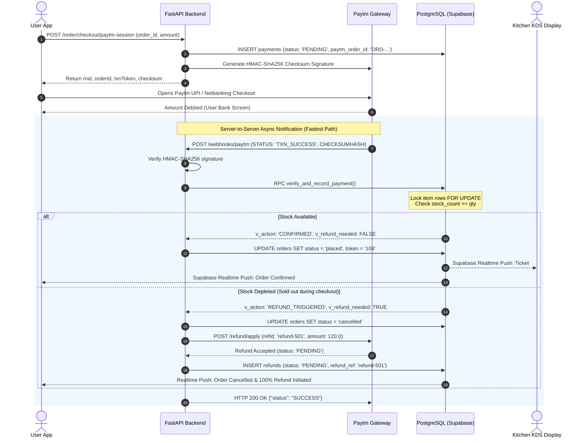
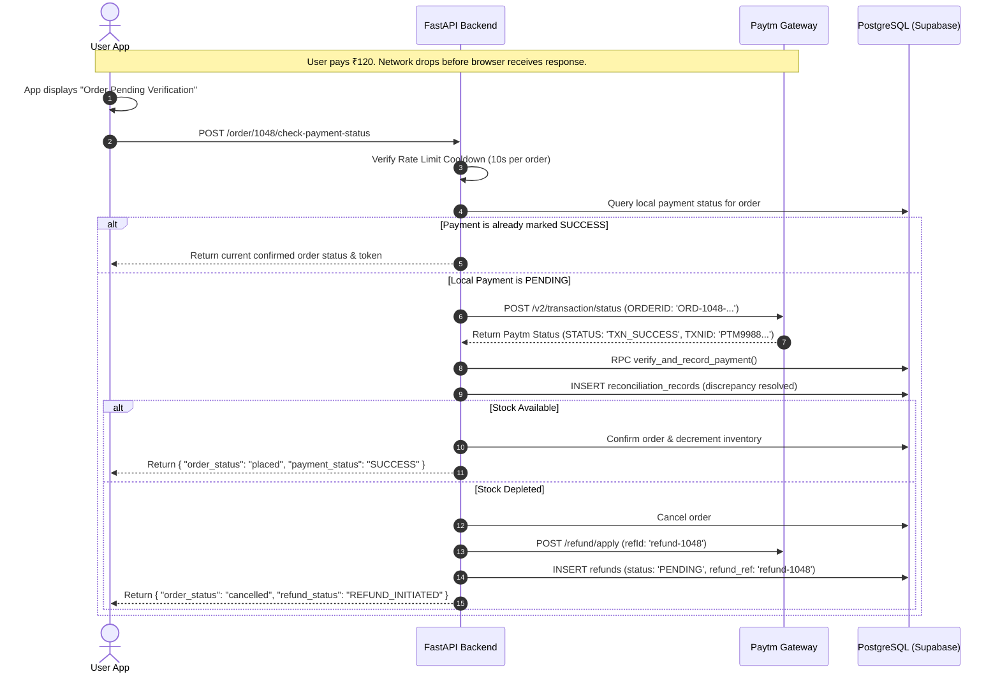
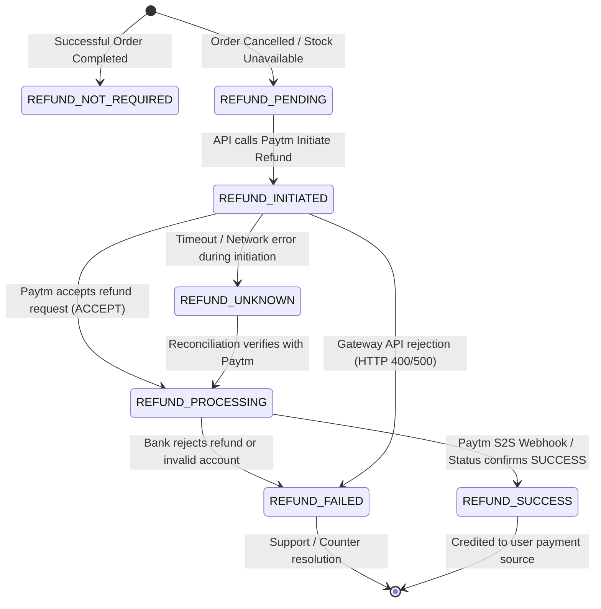

# V FOODS — Payment & Refund Flow Specification
## Sequence Diagrams, State Machines & Idempotency Controls

**Status**: Active Production Specification  
**Component**: Payment Verification, Refund Engine & Reconciliation  

---

## 1. Direct Order Payment & Confirmation Flow



---

## 2. Payment Debited But Order Not Confirmed Flow (Failure Recovery)

This is the primary failure path when campus mobile networks disconnect immediately after the user's bank accounts are debited.



---

## 3. The V Foods Refund State Machine

V Foods enforces an explicit 7-state refund lifecycle:



### State Definitions & Database Mapping

| Internal V Foods State | Paytm Gateway Event / Status | Trigger / Condition | UI Guidance Shown to User |
| :--- | :--- | :--- | :--- |
| `REFUND_NOT_REQUIRED` | `N/A` | Payment succeeded and order is preparing/completed. | Normal order progress. |
| `REFUND_PENDING` | `N/A` | Payment received but order cancelled/unfulfillable before gateway API call. | "Refund queued for processing." |
| `REFUND_INITIATED` | `ACCEPT` | Backend successfully submitted refund request to Paytm gateway. | "100% refund initiated to source account." |
| `REFUND_PROCESSING` | `PENDING` | Gateway forwarded refund to customer's issuing bank. | "Refund processing with issuing bank." |
| `REFUND_SUCCESS` | `TXN_SUCCESS` / `SUCCESS` | Gateway confirmed settlement back to user source account. | "Refund completed to original payment source." |
| `REFUND_FAILED` | `TXN_FAILURE` / `FAILURE` | Gateway or bank rejected refund (e.g., closed bank account). | "Refund issue detected. Tap Contact Outlet." |
| `REFUND_UNKNOWN` | `N/A (Timeout)` | Network failure during Paytm refund API request. | "Verifying refund status with gateway." |

---

## 4. Refund Idempotency Architecture

To prevent duplicate refund requests across network retries, automated jobs, and manual administrative triggers:

1. **Deterministic Idempotency Key**:
   The Paytm refund reference is constructed deterministically:
   ```python
   refId = f"refund-{payment_id}"
   ```
2. **Database Uniqueness Constraint**:
   ```sql
   ALTER TABLE public.refunds ADD CONSTRAINT uq_refunds_refund_ref UNIQUE (refund_ref);
   ```
3. **Atomic Verification Pre-Condition**:
   Before initiating a gateway refund, the backend queries existing refund rows:
   ```python
   existing_refund = sb.from_("refunds").select("id, status, refund_ref").eq("payment_id", payment_id).execute().data
   if existing_refund and existing_refund[0]["status"] in ("SUCCESS", "PROCESSING", "PENDING"):
       logger.info(f"Refund already active for payment {payment_id}: skipping duplicate API call")
       return existing_refund[0]
   ```
4. **Paytm Gateway Idempotency Guarantee**:
   According to official Paytm documentation, sending the same `refId` with identical amount returns the status of the existing refund rather than creating a duplicate financial debit.
