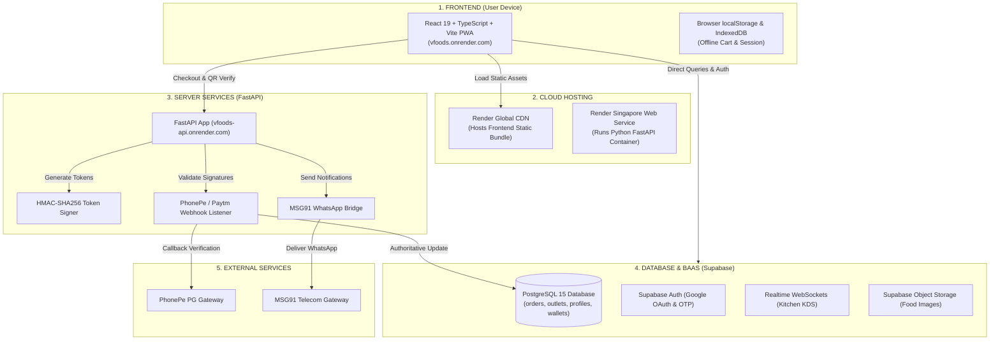

# V Foods — Complete Architecture & Technology Concepts Guide
> **A Concise, Plain-English Reference to Servers, Hosting, Databases, Backends, APIs, and Cloud Infrastructure**

---

## 1. Executive Summary: The 3 Core Layers

Every modern web application—from **V Foods** to Uber, Swiggy, and Netflix—consists of three distinct layers:

```
┌────────────────────────────────────────────────────────────────────────┐
│                        1. FRONTEND (Client)                            │
│  Runs in the user's browser. Renders UI, handles clicks and inputs.   │
│  Technologies: React 19, TypeScript, Vite, Tailwind CSS                │
└───────────────────────────────────┬────────────────────────────────────┘
                                    │  HTTPS / WebSockets
                                    ▼
┌────────────────────────────────────────────────────────────────────────┐
│                        2. BACKEND (Server Logic)                       │
│  Runs on cloud servers 24/7. Executes business rules and security.     │
│  Technologies: FastAPI (Python 3.11) + Supabase Edge Engine            │
└───────────────────────────────────┬────────────────────────────────────┘
                                    │  SQL Queries / Storage APIs
                                    ▼
┌────────────────────────────────────────────────────────────────────────┐
│                        3. DATABASE & STORAGE                           │
│  Persistent storage vault for structured data and media files.         │
│  Technologies: PostgreSQL 15 (Database) + Supabase S3 (Object Storage) │
└────────────────────────────────────────────────────────────────────────┘
```

---

## 2. The Restaurant Analogy

| Component | Restaurant Equivalent | Real-World Function |
| :--- | :--- | :--- |
| **Frontend** | **Dining Area & Menu Card** | What the customer interacts with: reads the menu, picks dishes, places an order. |
| **API** | **The Waiter** | Carries the order details from the table to the kitchen and brings back confirmation. |
| **Backend** | **The Kitchen & Master Chef** | Verifies ingredients, checks payments, coordinates cooking, and issues pickup tokens. |
| **Database** | **The Master Accounting Ledger** | Strict book tracking every rupee, inventory count, and completed order. |
| **File Storage** | **The Cold Storage Pantry** | Shelves holding heavy binary assets (food photos, brand logos, banner images). |
| **Server** | **The Kitchen Stoves & Equipment** | The physical hardware running 24/7 to process requests. |
| **Hosting (Render)** | **The Building Landlord** | Provides power, cooling, network connectivity, and continuous uptime. |
| **Domain Name** | **The Street Address & Signboard** | Friendly name (`vfoods.onrender.com`) mapping to underlying server IP addresses. |

---

## 3. Core Terminology Defined

### A. Frontend (Client-Side)
* **Definition**: Code running directly inside the user's browser (Chrome, Safari, Firefox).
* **V Foods Implementation**: **React 19 + TypeScript + Vite PWA**.
* **Responsibilities**: Food browsing, shopping cart, live order status tracking, Cashier Quick-Bill interface, Kitchen Display System (KDS).

### B. Backend (Server-Side)
* **Definition**: Code running on protected remote cloud servers. Inaccessible to the public.
* **V Foods Implementation**: **Python 3.11 + FastAPI** and **Supabase Cloud Engine**.
* **Responsibilities**: Payment verification, cryptographic QR generation, WhatsApp notifications, financial escrow settlement.

### C. API (Application Programming Interface)
* **Definition**: Structured HTTP endpoints enabling two different applications to exchange data.
* **Example**: Frontend POSTs order data to `/api/payment/verify`; backend responds with `{ "status": "PAID" }`.

### D. Server vs. Hosting
* **Server**: The computer (physical or virtual) running the operating system and application runtime.
* **Hosting**: The cloud provider (Render.com) managing server provisioning, network routing, SSL certificates, and zero-downtime deployments.
* **V Foods Cloud Location**: Render Singapore Data Center (AWS `ap-southeast-1`).

### E. Domain Names
* **Frontend Web App**: `https://vfoods.onrender.com`
* **Backend API Server**: `https://vfoods-api.onrender.com`
* **Database & BaaS**: `https://wahftohnwfoepuszvzrx.supabase.co`

---

## 4. Databases: SQL vs. NoSQL

A database stores and queries application data. Databases fall into two primary paradigms:

```
                         ┌───────────────────────────────────┐
                         │          DATABASE ENGINES         │
                         └─────────────────┬─────────────────┘
                                           │
                  ┌────────────────────────┴────────────────────────┐
                  ▼                                                 ▼
       ┌─────────────────────┐                           ┌─────────────────────┐
       │   SQL (Relational)  │                           │   NoSQL (Document)  │
       │   Tables & Columns  │                           │   JSON-like Objects │
       └──────────┬──────────┘                           └──────────┬──────────┘
                  │                                                 │
          • PostgreSQL (V Foods)                             • MongoDB
          • MySQL                                            • Firestore (Firebase)
          • SQLite / MariaDB                                 • DynamoDB (Amazon)
```

| Engine | Type | Data Structure | Best Use Case | In V Foods? |
| :--- | :--- | :--- | :--- | :--- |
| **PostgreSQL** | SQL (Relational) | Structured tables, columns, typed schemas, foreign keys | Financial systems, order transactions, relational joins | **YES (Primary)** |
| **MySQL** | SQL (Relational) | Structured tables and columns | General CMS (WordPress), legacy web platforms | No |
| **MongoDB** | NoSQL (Document) | Flexible JSON documents (`{ item: "Dosa", tags: [...] }`) | Unstructured catalogs, real-time activity feeds, chat logs | No |
| **Firestore** | NoSQL (Document) | Nested document collections in Google Cloud | Mobile apps with unstructured or rapidly shifting schemas | No |

### Why PostgreSQL Over MongoDB for V Foods:
1. **Relational Integrity**: Every order must link to a valid `user_id` and `outlet_id`. Foreign keys prevent orphaned records.
2. **ACID Transactions**: Financial operations (debiting wallet, crediting outlet balance, marking order `PAID`) must either all succeed or all roll back. PostgreSQL guarantees transaction atomicity; NoSQL document stores do not enforce multi-collection relational integrity by default.

---

## 5. Backend-as-a-Service (BaaS): Supabase vs. Firebase

### What is a BaaS?
Raw databases (PostgreSQL, MongoDB) cannot communicate directly with web browsers without an API layer. A **Backend-as-a-Service (BaaS)** provides pre-built backend services wrapped around a database:

1. **Authentication**: Built-in Google OAuth 2.0 and Email OTP.
2. **Auto-Generated APIs**: Instant RESTful endpoints via PostgREST.
3. **Realtime Engine**: WebSockets pushing instant database change events.
4. **Object Storage**: S3-compatible buckets for media files.
5. **Admin Dashboard**: Visual SQL and table editor.

### Comparison: Supabase vs. Firebase

| Feature | Supabase (V Foods) | Google Firebase |
| :--- | :--- | :--- |
| **Underlying Database** | **PostgreSQL (Relational SQL)** | **Firestore (NoSQL Document Store)** |
| **License** | Open Source | Proprietary (Google closed-source) |
| **Query Flexibility** | Full SQL (Joins, Aggregations, Triggers) | Limited NoSQL queries; no native joins |
| **Data Integrity** | Strict schema validation, foreign keys | Schema-less (app-level validation required) |
| **Vendor Portability** | High (standard PostgreSQL dump) | Low (tied to Google infrastructure) |

### Can Supabase Connect to MongoDB or MySQL?
* **No.** Supabase is strictly built on PostgreSQL. It cannot manage or query MongoDB or MySQL instances.
* Similarly, Firebase is strictly built on Firestore. Each BaaS platform is hard-wired to its specific database engine.

---

## 6. The Dual-Backend Architecture: Why FastAPI When We Already Have Supabase?

This is the most critical architectural concept in V Foods. We utilize **both Supabase and FastAPI**.

```
┌────────────────────────────────────────────────────────────────────────┐
│                              FRONTEND                                  │
│                      (React 19 Vite Browser App)                       │
└───────────────────┬────────────────────────────────┬───────────────────┘
                    │                                │
      Direct Public Operations              Sensitive Operations
      (Menu browsing, Auth, KDS socket)     (Payments, QR Signing, Alerts)
                    │                                │
                    ▼                                ▼
       ┌─────────────────────────┐      ┌─────────────────────────┐
       │     SUPABASE (BaaS)     │      │     FASTAPI BACKEND     │
       │   • PostgreSQL Database │      │   • Private API Secrets │
       │   • Supabase Auth       │      │   • Payment Webhooks    │
       │   • Realtime Sockets    │      │   • HMAC QR Crypto      │
       │   • Storage Buckets     │      │   • WhatsApp Gateway    │
       └─────────────────────────┘      └─────────────────────────┘
```

### Part 1: Why a Separate Backend Is Required At All (Despite Having Supabase)

Supabase allows the browser to read and write data directly using an anonymous public key protected by **Row Level Security (RLS)**. This is optimal for 90% of user interactions (browsing menus, checking active orders).

However, **client-side browsers are untrusted environments**. Anything inside JavaScript can be inspected via DevTools (`F12`). A private backend server is strictly necessary for five reasons:

1. **Payment Gateway Secret Keys**:
   * PhonePe and Paytm require a private `MERCHANT_SECRET_KEY` and `SALT_KEY` to authenticate transactions.
   * Storing these keys in frontend JavaScript allows any user to inspect the code, steal the merchant credentials, and forge fake payment confirmations.
   * **FastAPI stores secrets exclusively on the server** in protected environment variables.

2. **Authoritative Webhook Receivers**:
   * Payment gateways cannot notify a user's mobile browser directly when a payment completes. They call an external HTTP server URL (`/api/payment/callback`).
   * **FastAPI provides the persistent endpoint** that listens for payment callbacks, validates the cryptographic signature from PhonePe, and updates the database.

3. **Tamper-Proof HMAC-SHA256 Pickup QR Tokens**:
   * When food is ready, the user presents a pickup QR code at the counter.
   * If generated on the client, users could screenshot yesterday's code or fabricate tokens to claim unpaid meals.
   * **FastAPI signs tokens with a server-only secret (`QR_SECRET`) and a 120-second timestamp**, guaranteeing non-reusable, unforgeable pickup tokens.

4. **Third-Party Messaging Gateways**:
   * Sending WhatsApp or SMS confirmations via MSG91 requires private bearer tokens.
   * **FastAPI acts as the secure intermediary**, dispatching notifications without exposing gateway credentials.

5. **Financial Escrow & Commission Logic**:
   * Calculating fee splits (5% platform fee vs. 95% outlet revenue) must be executed by trusted server code to prevent client-side price tampering.

---

### Part 2: Why Choose FastAPI Ahead of Other Backend Frameworks?

Once the need for a dedicated backend is established, why select **FastAPI** over alternatives like **Express.js (Node.js)**, **Django**, **Flask**, **Spring Boot**, or **Go**?

| Framework | Language | Async Performance | Built-in Validation | Documentation | Architectural Fit for V Foods |
| :--- | :--- | :--- | :--- | :--- | :--- |
| **FastAPI** | Python | **Ultra-High** (Starlette/ASGI) | **Automatic** (Pydantic schemas) | **Auto-Generated** (Swagger / OpenAPI) | **Optimal**. Lightweight, typed, native async, low RAM footprint. |
| **Express.js** | JavaScript | High (Event Loop) | Manual (Requires extra libraries) | Manual (Requires Swagger config) | Good, but lacks built-in data validation and auto docs out of the box. |
| **Django** | Python | Moderate (WSGI/ASGI hybrid) | Complex (Django Forms/Serializers) | Manual (drf-spectacular) | **Too heavy**. Includes full ORM, templating, and admin panels that duplicate Supabase features. |
| **Flask** | Python | Low-Moderate (Synchronous WSGI) | Manual | Manual | Legacy architecture; lacks native async processing and typing. |
| **Spring Boot** | Java | High | Annotation-based | Springdoc OpenAPI | **Resource Heavy**. High memory consumption (512MB-1GB RAM minimum); slow cold starts on free/starter cloud tiers. |
| **Go (Gin/Fiber)**| Go | Ultra-High | Struct tags | Swag CLI | High performance, but slower development velocity and verbose cryptographic boilerplate. |

#### Key Technical Reasons for FastAPI:
1. **Asynchronous Throughput for High-Concurrency Webhooks**:
   * FastAPI runs on **ASGI (Asynchronous Server Gateway Interface)** via `Uvicorn` and `Starlette`.
   * When hundreds of simultaneous payment callbacks hit the API during peak lunch hours, FastAPI handles them non-blockingly on an event loop without thread starvation.
2. **Automatic Schema Validation via Pydantic**:
   * Incoming request payloads (payment status, order IDs, token hashes) are strictly validated against Pydantic models before execution. Malformed or malicious requests are rejected instantly at the HTTP layer.
3. **No Redundant Bloat**:
   * Unlike Django (which bundles a monolithic ORM, template renderer, and migration engine), FastAPI is a lightweight micro-framework. Because Supabase already manages the PostgreSQL database, FastAPI remains small, fast, and uses under 50 MB of RAM on Render.
4. **Native Python Cryptography**:
   * Python provides standard, battle-tested cryptographic modules (`hmac`, `hashlib`, `secrets`) for secure QR token generation and signature verification.
5. **Self-Documenting Interactive API**:
   * FastAPI automatically generates an interactive OpenAPI/Swagger interface at `/docs`, enabling immediate endpoint testing.

---

## 7. Database Storage vs. File/Object Storage

| Feature | Relational Database (PostgreSQL) | Object Storage (Supabase Storage) |
| :--- | :--- | :--- |
| **Data Stored** | Text, numbers, timestamps, IDs, monetary amounts, JSON | Heavy binary files: JPEG, PNG, WEBP photos, PDF invoices |
| **Format** | Strict relational tables with typed columns | Flat file buckets with unique file paths |
| **Typical Item Size** | < 1 Kilobyte per record | 100 Kilobytes to 10 Megabytes per file |
| **Why Separate?** | Storing binary images directly inside database columns (BLOBs) degrades query performance, inflates memory usage, and slows database backups. |
| **V Foods Architecture** | The image file is stored in a Supabase S3 bucket. The database table only stores the lightweight **public URL string** pointing to the image (`https://.../burger.webp`). |

---

## 8. Complete V Foods Technology Stack



### Infrastructure Summary:

| Layer | Technology | Hosting Provider | Primary Responsibility |
| :--- | :--- | :--- | :--- |
| **Frontend** | React 19, TypeScript, Vite, Tailwind | Render CDN | Interactive UI, cart, responsive mobile PWA |
| **Backend API** | Python 3.11, FastAPI, Uvicorn | Render (Singapore) | Payment webhooks, HMAC QR generation, WhatsApp gateway |
| **Database** | PostgreSQL 15+ | Supabase (AWS Singapore) | ACID relational data storage, foreign key constraints |
| **Auth** | Supabase Auth | Supabase | User session tokens, Google OAuth 2.0, Email OTP |
| **Realtime** | Supabase Realtime | Supabase | Instant WebSocket push to kitchen counters |
| **File Storage** | Supabase Storage | Supabase S3 | CDN hosting for food photography and logos |
| **Payment Gateway**| PhonePe PG / Paytm / UPI | Bank Gateways | Authoritative financial transaction processing |
| **Messaging** | MSG91 | Telecom Provider | WhatsApp order alerts and SMS delivery |

---

## 9. Life of a Food Order: End-to-End Execution Flow

```
 [User Device]              [FastAPI Server]             [PhonePe Gateway]          [Supabase Database]        [Kitchen Display (KDS)]
       │                            │                            │                         │                         │
  1. Taps "Pay ₹120"                │                            │                         │                         │
       ├───────────────────────────►│                            │                         │                         │
       │  Initiates checkout        │                            │                         │                         │
       │                            ├───────────────────────────►│                         │                         │
       │                            │  2. Creates payment order  │                         │                         │
       │                            │◄───────────────────────────┤                         │                         │
       │◄───────────────────────────┤  Returns UPI pay link      │                         │                         │
       │  Redirects to PhonePe/UPI  │                            │                         │                         │
       │                                                         │                         │                         │
       │  3. User completes UPI PIN                              │                         │                         │
       │  ──────────────────────────────────────────────────────►│                         │                         │
       │                                                         │  4. Payment successful! │                         │
       │                            │◄───────────────────────────┤     (Sends Webhook)     │                         │
       │                            │  Validates HMAC signature  │                         │                         │
       │                            ├─────────────────────────────────────────────────────►│                         │
       │                            │  5. Updates Order: status = "PAID"                   │                         │
       │                            │                                                      ├────────────────────────►│
       │                            │                                                      │  6. WebSocket triggers  │
       │                            │                                                      │     live order chime    │
       │                            ├──────────────────────────────────────────────────────┼─────────────┐           │
       │                            │  7. Sends WhatsApp confirmation                      │             ▼           │
       │                            │                                                      │      [User Phone]       │
       │◄───────────────────────────┴──────────────────────────────────────────────────────┴── WhatsApp Notification
  8. Generates dynamic HMAC pickup QR token on screen
```

---

## 10. Summary Cheat Sheet

| Question | Direct Answer |
| :--- | :--- |
| **What is our frontend?** | **React 19 + TypeScript + Vite**, hosted on Render at `https://vfoods.onrender.com`. |
| **What is our database?** | **PostgreSQL 15**, hosted and managed inside **Supabase**. |
| **Is Supabase a database or a backend?** | **Both.** It bundles a PostgreSQL database with managed backend services (Auth, APIs, Realtime, Storage). |
| **Can we access MongoDB or MySQL via Supabase?** | **No.** Supabase is built exclusively on PostgreSQL. |
| **Why use a separate backend if we already have Supabase?** | To enforce a secure trust boundary. The browser cannot safely hold private payment keys, receive payment webhooks, sign anti-fraud QR codes, or access MSG91 messaging credentials. |
| **Why choose FastAPI over other backends?** | High async throughput (handles peak lunch webhook concurrency), automatic request validation via Pydantic, zero unnecessary bloat (under 50MB RAM), native Python cryptography, and auto-generated API documentation. |
| **Where are image files stored?** | In **Supabase Cloud Object Storage buckets**, while only the URL strings are stored in the PostgreSQL database. |
| **Where are the cloud servers physically located?** | In **Singapore** (AWS `ap-southeast-1`), deployed via Render and Supabase. |

---

*Document: System Architecture & Technology Concepts Guide*  
*Project: V Foods Smart Campus Dining System*  
*Revision: 2.0.0 (Concise Edition)*  
