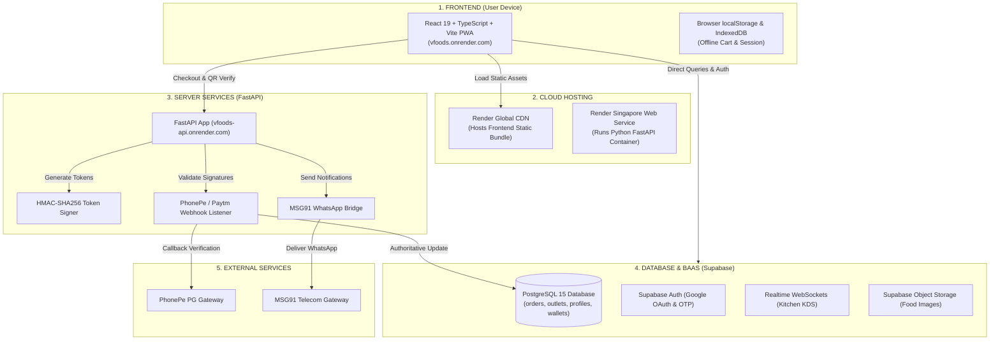

# V Foods — Complete Architecture & Technology Concepts Guide
> **A Concise, Plain-English Reference to Servers, Hosting, Databases, Backends, APIs, and Cloud Infrastructure**

---

## 1. Executive Summary: The 3 Core Layers

Every modern web application—from **V Foods** to Uber, Swiggy, and Netflix—consists of three distinct layers:

```
┌────────────────────────────────────────────────────────────────────────┐
│                        1. FRONTEND (Client)                            │
│  Runs in the user's browser. Renders UI, handles clicks and inputs.   │
│  Technologies: React 19, TypeScript, Vite, Tailwind CSS                │
└───────────────────────────────────┬────────────────────────────────────┘
                                    │  HTTPS / WebSockets
                                    ▼
┌────────────────────────────────────────────────────────────────────────┐
│                        2. BACKEND (Server Logic)                       │
│  Runs on cloud servers 24/7. Executes business rules and security.     │
│  Technologies: FastAPI (Python 3.11) + Supabase Edge Engine            │
└───────────────────────────────────┬────────────────────────────────────┘
                                    │  SQL Queries / Storage APIs
                                    ▼
┌────────────────────────────────────────────────────────────────────────┐
│                        3. DATABASE & STORAGE                           │
│  Persistent storage vault for structured data and media files.         │
│  Technologies: PostgreSQL 15 (Database) + Supabase S3 (Object Storage) │
└────────────────────────────────────────────────────────────────────────┘
```

---

## 2. The Restaurant Analogy

| Component | Restaurant Equivalent | Real-World Function |
| :--- | :--- | :--- |
| **Frontend** | **Dining Area & Menu Card** | What the customer interacts with: reads the menu, picks dishes, places an order. |
| **API** | **The Waiter** | Carries the order details from the table to the kitchen and brings back confirmation. |
| **Backend** | **The Kitchen & Master Chef** | Verifies ingredients, checks payments, coordinates cooking, and issues pickup tokens. |
| **Database** | **The Master Accounting Ledger** | Strict book tracking every rupee, inventory count, and completed order. |
| **File Storage** | **The Cold Storage Pantry** | Shelves holding heavy binary assets (food photos, brand logos, banner images). |
| **Server** | **The Kitchen Stoves & Equipment** | The physical hardware running 24/7 to process requests. |
| **Hosting (Render)** | **The Building Landlord** | Provides power, cooling, network connectivity, and continuous uptime. |
| **Domain Name** | **The Street Address & Signboard** | Friendly name (`vfoods.onrender.com`) mapping to underlying server IP addresses. |

---

## 3. Server vs. Hosting vs. Domain vs. IP vs. DNS

These terms are frequently confused. Here is the complete breakdown in simple, everyday language:

```
┌─────────────────────────────────────────────────────────────────────────┐
│                     THE EVERYDAY REAL-WORLD ANALOGY                     │
│                                                                         │
│  1. Server      = The physical telephone handset in your hand.          │
│  2. Hosting     = The telecom carrier (Airtel/Jio) powering the tower.  │
│  3. IP Address  = The raw 10-digit phone number (+91 98765 43210).      │
│  4. Domain Name = The friendly contact name in your address book ("Mom").│
│  5. DNS         = The phonebook app translating "Mom" -> +91 98765 43210│
└─────────────────────────────────────────────────────────────────────────┘
```

### How They Connect in Real Life:

```
┌─────────────────────────────────────────────────────────────────────────┐
│                      HOW THEY CONNECT IN REAL LIFE                      │
│                                                                         │
│  User types: vfoods.onrender.com (DOMAIN NAME)                          │
│                         │                                               │
│                         ▼ (DNS translates name to numbers)              │
│               IP: 216.24.57.1 (IP ADDRESS)                              │
│                         │                                               │
│                         ▼ (Routes traffic to the cloud provider)        │
│             Render.com Singapore (HOSTING)                              │
│                         │                                               │
│                         ▼ (Delivers request to the physical computer)   │
│             Linux CPU & Memory (SERVER)                                 │
└─────────────────────────────────────────────────────────────────────────┘
```

### Detailed Terminology:

| Term | In Plain English | Everyday Analogy | In V Foods |
| :--- | :--- | :--- | :--- |
| **Server** | A physical computer without a monitor or keyboard that stays powered on 24/7 connected to high-speed internet to execute code. | The stove and physical equipment inside a commercial kitchen. | Linux container machines running Python 3.11 and NodeJS. |
| **Hosting** | The cloud company that owns the server warehouse, pays for electricity, provides cooling, and manages 99.9% uptime. | The landlord renting you the commercial building and guaranteeing 24/7 power and security. | **Render.com** (Frontend & API) and **Supabase/AWS** (Database). |
| **IP Address** | The exact numerical network address assigned to a server on the internet (e.g., `216.24.57.1`). | Raw GPS coordinates (`12.9716° N, 77.5946° E`). | The internal cloud network addresses routing traffic to our containers. |
| **Domain Name** | The human-friendly name typed into a browser address bar so users don't have to memorize raw IP numbers. | The street address or branded signboard on top of the store ("V Foods Canteen"). | `https://vfoods.onrender.com` (Frontend) and `https://vfoods-api.onrender.com` (API). |
| **DNS (Domain Name System)**| The global internet phonebook that automatically translates a domain name into its corresponding IP address. | Your phone's Contact List: you tap "Mom" and your phone dials `+91 98765 43210`. | Cloudflare / Render DNS routing incoming traffic to Singapore servers. |

---

## 4. Databases: SQL vs. NoSQL

A database stores and queries application data. Databases fall into two primary paradigms:

```
                         ┌───────────────────────────────────┐
                         │          DATABASE ENGINES         │
                         └─────────────────┬─────────────────┘
                                           │
                  ┌────────────────────────┴────────────────────────┐
                  ▼                                                 ▼
       ┌─────────────────────┐                           ┌─────────────────────┐
       │   SQL (Relational)  │                           │   NoSQL (Document)  │
       │   Tables & Columns  │                           │   JSON-like Objects │
       └──────────┬──────────┘                           └──────────┬──────────┘
                  │                                                 │
          • PostgreSQL (V Foods)                             • MongoDB
          • MySQL                                            • Firestore (Firebase)
          • SQLite / MariaDB                                 • DynamoDB (Amazon)
```

| Engine | Type | Data Structure | Best Use Case | In V Foods? |
| :--- | :--- | :--- | :--- | :--- |
| **PostgreSQL** | SQL (Relational) | Structured tables, columns, typed schemas, foreign keys | Financial systems, order transactions, relational joins | **YES (Primary)** |
| **MySQL** | SQL (Relational) | Structured tables and columns | General CMS (WordPress), legacy web platforms | No |
| **MongoDB** | NoSQL (Document) | Flexible JSON documents (`{ item: "Dosa", tags: [...] }`) | Unstructured catalogs, real-time activity feeds, chat logs | No |
| **Firestore** | NoSQL (Document) | Nested document collections in Google Cloud | Mobile apps with unstructured or rapidly shifting schemas | No |

### Why PostgreSQL Over MongoDB for V Foods:
1. **Relational Integrity**: Every order must link to a valid `user_id` and `outlet_id`. Foreign keys prevent orphaned records.
2. **ACID Transactions**: Financial operations (debiting wallet, crediting outlet balance, marking order `PAID`) must either all succeed or all roll back. PostgreSQL guarantees transaction atomicity; NoSQL document stores do not enforce multi-collection relational integrity by default.

---

## 5. Backend-as-a-Service (BaaS): Supabase vs. Firebase

### What is a BaaS?
Raw databases (PostgreSQL, MongoDB) cannot communicate directly with web browsers without an API layer. A **Backend-as-a-Service (BaaS)** provides pre-built backend services wrapped around a database:

1. **Authentication**: Built-in Google OAuth 2.0 and Email OTP.
2. **Auto-Generated APIs**: Instant RESTful endpoints via PostgREST.
3. **Realtime Engine**: WebSockets pushing instant database change events.
4. **Object Storage**: S3-compatible buckets for media files.
5. **Admin Dashboard**: Visual SQL and table editor.

### Comparison: Supabase vs. Firebase

| Feature | Supabase (V Foods) | Google Firebase |
| :--- | :--- | :--- |
| **Underlying Database** | **PostgreSQL (Relational SQL)** | **Firestore (NoSQL Document Store)** |
| **License** | Open Source | Proprietary (Google closed-source) |
| **Query Flexibility** | Full SQL (Joins, Aggregations, Triggers) | Limited NoSQL queries; no native joins |
| **Data Integrity** | Strict schema validation, foreign keys | Schema-less (app-level validation required) |
| **Vendor Portability** | High (standard PostgreSQL dump) | Low (tied to Google infrastructure) |

### Can Supabase Connect to MongoDB or MySQL?
* **No.** Supabase is strictly built on PostgreSQL. It cannot manage or query MongoDB or MySQL instances.
* Similarly, Firebase is strictly built on Firestore. Each BaaS platform is hard-wired to its specific database engine.

---

## 6. The Dual-Backend Architecture: Why FastAPI When We Already Have Supabase?

We utilize **both Supabase and FastAPI**.

```
┌────────────────────────────────────────────────────────────────────────┐
│                              FRONTEND                                  │
│                      (React 19 Vite Browser App)                       │
└───────────────────┬────────────────────────────────┬───────────────────┘
                    │                                │
      Direct Public Operations              Sensitive Operations
      (Menu browsing, Auth, KDS socket)     (Payments, QR Signing, Alerts)
                    │                                │
                    ▼                                ▼
       ┌─────────────────────────┐      ┌─────────────────────────┐
       │     SUPABASE (BaaS)     │      │     FASTAPI BACKEND     │
       │   • PostgreSQL Database │      │   • Private API Secrets │
       │   • Supabase Auth       │      │   • Payment Webhooks    │
       │   • Realtime Sockets    │      │   • HMAC QR Crypto      │
       │   • Storage Buckets     │      │   • WhatsApp Gateway    │
       └─────────────────────────┘      └─────────────────────────┘
```

### Part 1: Why a Separate Backend Is Required At All (Fraud & Scam Prevention)

Supabase allows the browser to read and write data directly using an anonymous public key protected by **Row Level Security (RLS)**. This is optimal for 90% of user interactions (browsing menus, checking active orders).

However, **client-side browsers are untrusted environments**. Anything inside JavaScript can be inspected via DevTools (`F12`). A private backend server is strictly necessary to prevent 4 major financial scams:

#### 1. Scam: "Fake Payment Confirmation" (Editing Browser Code)
* **How people try to scam**: A user inspects the browser (`F12`), edits the JavaScript response from `FAILED` to `SUCCESS`, and attempts to claim free food without paying.
* **How FastAPI stops it**: The user’s phone **never** confirms payment status. PhonePe’s bank server calls FastAPI directly via a secret server-to-server webhook (`/api/payment/callback`). FastAPI validates the bank's mathematical digital signature using a private `SALT_KEY`. If money was not settled, the order is rejected.

#### 2. Scam: "Screenshotting or Forging Pickup QR Codes"
* **How people try to scam**: A user buys one meal, screenshots the QR code, sends it to multiple friends via chat, and attempts multiple meal collections.
* **How FastAPI stops it**: FastAPI uses **HMAC-SHA256 cryptography** and a secret server key (`QR_SECRET`) to create a **dynamic, single-use token with a 120-second timestamp**. Once the cashier scans it, it is burned and marked used. Old screenshots are rejected immediately.

#### 3. Scam: "Price Tampering" (Changing ₹150 to ₹1)
* **How people try to scam**: A malicious user alters the shopping cart data in their browser to pay ₹1 for a ₹150 item.
* **How FastAPI stops it**: FastAPI never trusts the price sent from the client device. It queries the official price directly from PostgreSQL and submits the authoritative total to PhonePe.

#### 4. Scam: "Stealing Merchant & WhatsApp Gateway Keys"
* **How people try to scam**: Attackers inspect frontend JavaScript bundles to extract API keys and drain telecom or payment gateway accounts.
* **How FastAPI stops it**: All private keys stay locked on the FastAPI cloud server in environment variables. The browser never receives them.

---

### Part 2: Why Choose FastAPI Ahead of Other Backend Frameworks?

| Framework | Language | Async Performance | Built-in Validation | Documentation | Architectural Fit for V Foods |
| :--- | :--- | :--- | :--- | :--- | :--- |
| **FastAPI** | Python | **Ultra-High** (Starlette/ASGI) | **Automatic** (Pydantic schemas) | **Auto-Generated** (Swagger / OpenAPI) | **Optimal**. Lightweight, typed, native async, low RAM footprint. |
| **Express.js** | JavaScript | High (Event Loop) | Manual (Requires extra libraries) | Manual (Requires Swagger config) | Good, but lacks built-in data validation and auto docs out of the box. |
| **Django** | Python | Moderate (WSGI/ASGI hybrid) | Complex (Django Forms/Serializers) | Manual (drf-spectacular) | **Too heavy**. Monolithic ORM and template engine duplicate Supabase features. |
| **Flask** | Python | Low-Moderate (Synchronous WSGI) | Manual | Manual | Legacy architecture; lacks native async processing for high-volume webhook bursts. |
| **Spring Boot** | Java | High | Annotation-based | Springdoc OpenAPI | **Resource Heavy**. High memory consumption (512MB-1GB RAM minimum); slow cold starts on free/starter cloud tiers. |
| **Go (Gin/Fiber)**| Go | Ultra-High | Struct tags | Swag CLI | High performance, but slower development velocity and verbose cryptographic boilerplate. |

#### Key Technical Reasons for FastAPI:
1. **Asynchronous Throughput for High-Concurrency Webhooks**:
   * FastAPI runs on **ASGI** via `Uvicorn` and `Starlette`.
   * When hundreds of simultaneous payment callbacks hit the API during peak lunch hours, FastAPI handles them non-blockingly on an event loop without thread starvation.
2. **Automatic Schema Validation via Pydantic**:
   * Incoming request payloads (payment status, order IDs, token hashes) are strictly validated against Pydantic models before execution. Malformed or malicious requests are rejected instantly at the HTTP layer.
3. **No Redundant Bloat**:
   * Unlike Django (which bundles an ORM, template engine, and admin panel), FastAPI is a lightweight micro-framework. Because Supabase already manages PostgreSQL, FastAPI uses under 50 MB of RAM on Render.
4. **Native Python Cryptography**:
   * Python provides standard, battle-tested cryptographic modules (`hmac`, `hashlib`, `secrets`) for secure QR token generation and signature verification.
5. **Self-Documenting Interactive API**:
   * FastAPI automatically generates an interactive OpenAPI/Swagger interface at `/docs`, enabling immediate endpoint testing.

---

## 7. Database vs. File/Object Storage: Why They Are NOT the Same

A database and a file storage system serve two completely different purposes:

> **Database is for structured text and numbers (searchable data).**  
> **Storage is for heavy binary files (photos, videos, PDFs).**

```
┌────────────────────────────────────────────────────────────────────────┐
│                        THE EVERYDAY DISTINCTION                        │
│                                                                        │
│  DATABASE (PostgreSQL)       STORAGE (Supabase Storage / S3)           │
│  An Excel Spreadsheet        A Google Drive Folder / Filing Cabinet    │
│  Rows and columns of text    Holds 3 MB image files and PDFs           │
│  Quick calculations & totals Delivers photos fast via CDN              │
└────────────────────────────────────────────────────────────────────────┘
```

### Real-World Example: Adding "Paneer Butter Masala" to the Menu

1. **Step 1: Upload the Photo to File Storage**:
   * The canteen manager uploads a 2.5 MB food photo.
   * It is stored in a **Supabase Storage Bucket** (like a private Google Drive folder).
   * Storage provides a short public URL:  
     `https://wahftohnwfoepuszvzrx.supabase.co/storage/v1/object/public/food/paneer.webp`

2. **Step 2: Save the Text Record in the Database**:
   * The **PostgreSQL Database** stores a lightweight row:

| id | item_name | price | category | image_url |
| :--- | :--- | :--- | :--- | :--- |
| 108 | Paneer Butter Masala | ₹140 | North Indian | `https://.../paneer.webp` |

> **The Golden Rule**: The heavy 3MB photo is stored in **Storage (Google Drive / S3)**. The **Database (Excel table)** only saves the short text link: `https://.../biryani.webp`.

### Why Can't We Store Photos Directly Inside the Database?
1. **Performance & Query Speed**: Databases search millions of rows in milliseconds. Storing multi-megabyte image binaries directly in database rows (as BLOBs) saturates database memory and degrades search speed.
2. **Infrastructure Cost**: Relational database storage relies on expensive high-speed RAM and NVMe SSDs. Object Storage (S3 / Supabase Storage) is **up to 10x cheaper** per gigabyte.
3. **Backups & Reliability**: A text-only database backup completes in 2 seconds. Backing up a database containing 50 GB of embedded photo files takes hours and risks database timeouts during peak traffic.

---

## 8. Complete V Foods Technology Stack



### Infrastructure Summary:

| Layer | Technology | Hosting Provider | Primary Responsibility |
| :--- | :--- | :--- | :--- |
| **Frontend** | React 19, TypeScript, Vite, Tailwind | Render CDN | Interactive UI, cart, responsive mobile PWA |
| **Backend API** | Python 3.11, FastAPI, Uvicorn | Render (Singapore) | Payment webhooks, HMAC QR generation, WhatsApp gateway |
| **Database** | PostgreSQL 15+ | Supabase (AWS Singapore) | ACID relational data storage, foreign key constraints |
| **Auth** | Supabase Auth | Supabase | User session tokens, Google OAuth 2.0, Email OTP |
| **Realtime** | Supabase Realtime | Supabase | Instant WebSocket push to kitchen counters |
| **File Storage** | Supabase Storage | Supabase S3 | CDN hosting for food photography and logos |
| **Payment Gateway**| PhonePe PG / Paytm / UPI | Bank Gateways | Authoritative financial transaction processing |
| **Messaging** | MSG91 | Telecom Provider | WhatsApp order alerts and SMS delivery |

---

## 9. Life of a Food Order: End-to-End Execution Flow

```
 [User Device]              [FastAPI Server]             [PhonePe Gateway]          [Supabase Database]        [Kitchen Display (KDS)]
       │                            │                            │                         │                         │
  1. Taps "Pay ₹120"                │                            │                         │                         │
       ├───────────────────────────►│                            │                         │                         │
       │  Initiates checkout        │                            │                         │                         │
       │                            ├───────────────────────────►│                         │                         │
       │                            │  2. Creates payment order  │                         │                         │
       │                            │◄───────────────────────────┤                         │                         │
       │◄───────────────────────────┤  Returns UPI pay link      │                         │                         │
       │  Redirects to PhonePe/UPI  │                            │                         │                         │
       │                                                         │                         │                         │
       │  3. User completes UPI PIN                              │                         │                         │
       │  ──────────────────────────────────────────────────────►│                         │                         │
       │                                                         │  4. Payment successful! │                         │
       │                            │◄───────────────────────────┤     (Sends Webhook)     │                         │
       │                            │  Validates HMAC signature  │                         │                         │
       │                            ├─────────────────────────────────────────────────────►│                         │
       │                            │  5. Updates Order: status = "PAID"                   │                         │
       │                            │                                                      ├────────────────────────►│
       │                            │                                                      │  6. WebSocket triggers  │
       │                            │                                                      │     live order chime    │
       │                            ├──────────────────────────────────────────────────────┼─────────────┐           │
       │                            │  7. Sends WhatsApp confirmation                      │             ▼           │
       │                            │                                                      │      [User Phone]       │
       │◄───────────────────────────┴──────────────────────────────────────────────────────┴── WhatsApp Notification
  8. Generates dynamic HMAC pickup QR token on screen
```

---

## 10. Frequently Asked Questions (FAQ)

### Q1: Can a web app work with only a Frontend and a Database, with no backend server at all?
* **Only for simple toy apps or public blogs.**
* If your application handles real money, payments, or secret keys, you **cannot** run without a private backend. A browser is completely open to the user; putting private keys in a browser allows anyone to steal them.

### Q2: Is Supabase and Firebase the same as MongoDB and MySQL?
* **No.** MongoDB and MySQL are **raw database engines**. They do not have user login systems, file storage, or instant web APIs built-in.
* Supabase and Firebase are **Backend-as-a-Service (BaaS)** platforms that bundle a database together with user authentication, file storage, and real-time syncing out of the box.

### Q3: What is the difference between an API and a Server?
* A **Server** is the physical or virtual computer.
* An **API** is the software door or window on that computer that allows other computers to request information (like `/api/get-menu`).

### Q4: Why is Render called "Hosting" and not just a "Server"?
* A server is just the computer hardware.
* **Hosting** is the complete managed service provided by Render: they handle the building, power, cooling, Linux setup, network firewalls, DDoS protection, SSL certificates (`https`), and automatic deployments from GitHub.

---

## 11. Summary Cheat Sheet

| Question | Direct Answer |
| :--- | :--- |
| **What is our frontend?** | **React 19 + TypeScript + Vite**, hosted on Render at `https://vfoods.onrender.com`. |
| **What is our database?** | **PostgreSQL 15**, hosted and managed inside **Supabase**. |
| **Is Supabase a database or a backend?** | **Both.** It bundles a PostgreSQL database with managed backend services (Auth, APIs, Realtime, Storage). |
| **Can we access MongoDB or MySQL via Supabase?** | **No.** Supabase is built exclusively on PostgreSQL. |
| **Is database and storage the same?** | **No.** Databases store structured text and numbers (Excel sheet). Storage stores heavy binary files like photos and PDFs (Google Drive). |
| **Why use a separate backend if we already have Supabase?** | To enforce a secure trust boundary and stop scams (payment falsification, screenshotting QR codes, cart price tampering, and API key theft). |
| **Why choose FastAPI over other backends?** | High async throughput (handles peak lunch webhook concurrency), automatic request validation via Pydantic, zero unnecessary bloat (under 50MB RAM), native Python cryptography, and auto-generated API documentation. |
| **Where are image files stored?** | In **Supabase Cloud Object Storage buckets**, while only the URL strings are stored in the PostgreSQL database. |
| **Where are the cloud servers physically located?** | In **Singapore** (AWS `ap-southeast-1`), deployed via Render and Supabase. |

---

*Document: System Architecture & Technology Concepts Guide*  
*Project: V Foods Smart Campus Dining System*  
*Revision: 2.2.0 (Master Comprehensive Edition)*  
